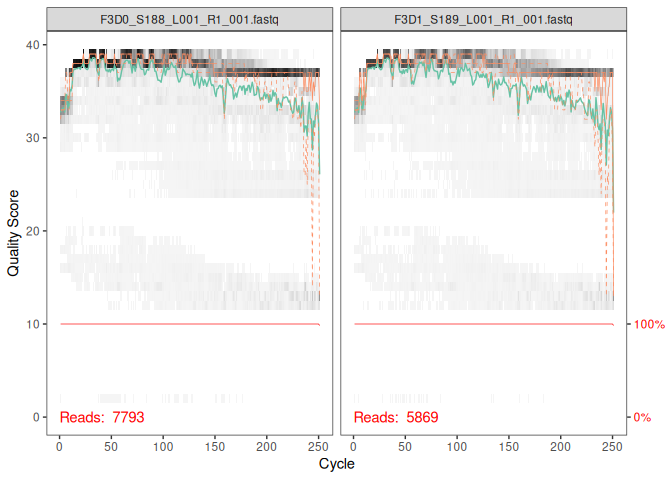
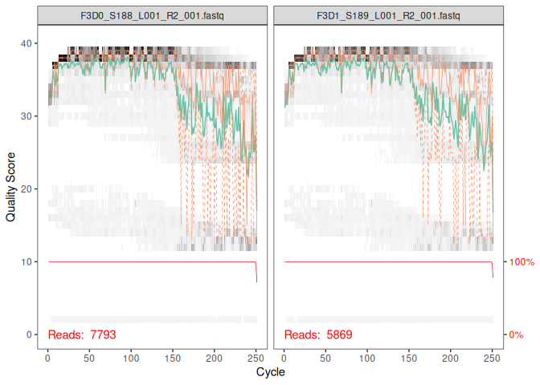
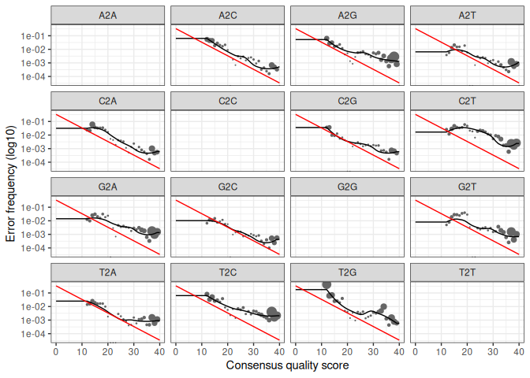
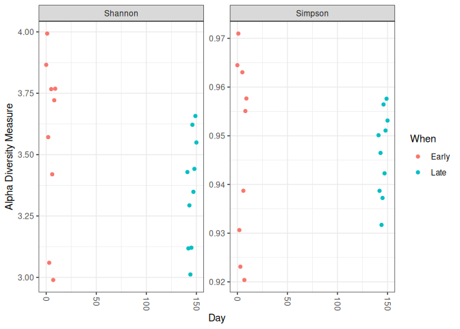
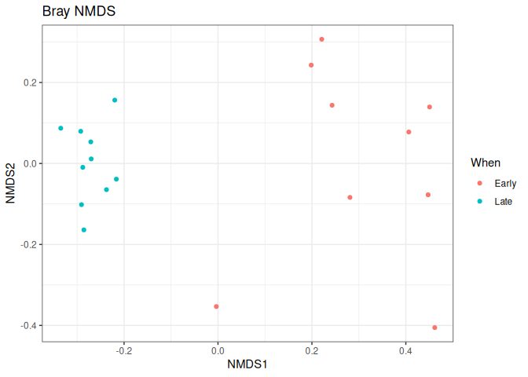
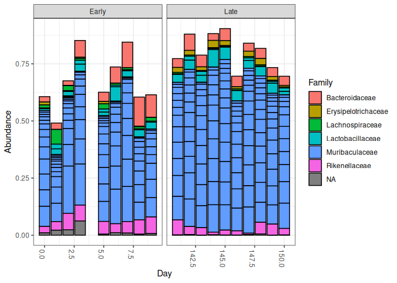

R Notebook
================

``` r
if (!requireNamespace("BiocManager", quietly = TRUE))
    install.packages("BiocManager")
BiocManager::install("dada2", version = "3.23")
```

    ## 'getOption("repos")' replaces Bioconductor standard repositories, see
    ## 'help("repositories", package = "BiocManager")' for details.
    ## Replacement repositories:
    ##     CRAN: https://p3m.dev/cran/__linux__/noble/latest

    ## Bioconductor version 3.23 (BiocManager 1.30.27), R 4.6.1 (2026-06-24)

    ## Warning: package(s) not installed when version(s) same as or greater than current; use
    ##   `force = TRUE` to re-install: 'dada2'

    ## Installation paths not writeable, unable to update packages
    ##   path: /usr/local/lib/R/library
    ##   packages:
    ##     class, cluster, foreign, KernSmooth, lattice, MASS, Matrix, mgcv, nlme,
    ##     nnet, spatial, survival

``` r
library(dada2); packageVersion("dada2")
```

    ## Loading required package: Rcpp

    ## [1] '1.40.0'

``` r
path <- "~/ADM_dada2/MiSeq_SOP" 
list.files(path)
```

    ##  [1] "F3D0_S188_L001_R1_001.fastq"   "F3D0_S188_L001_R2_001.fastq"  
    ##  [3] "F3D1_S189_L001_R1_001.fastq"   "F3D1_S189_L001_R2_001.fastq"  
    ##  [5] "F3D141_S207_L001_R1_001.fastq" "F3D141_S207_L001_R2_001.fastq"
    ##  [7] "F3D142_S208_L001_R1_001.fastq" "F3D142_S208_L001_R2_001.fastq"
    ##  [9] "F3D143_S209_L001_R1_001.fastq" "F3D143_S209_L001_R2_001.fastq"
    ## [11] "F3D144_S210_L001_R1_001.fastq" "F3D144_S210_L001_R2_001.fastq"
    ## [13] "F3D145_S211_L001_R1_001.fastq" "F3D145_S211_L001_R2_001.fastq"
    ## [15] "F3D146_S212_L001_R1_001.fastq" "F3D146_S212_L001_R2_001.fastq"
    ## [17] "F3D147_S213_L001_R1_001.fastq" "F3D147_S213_L001_R2_001.fastq"
    ## [19] "F3D148_S214_L001_R1_001.fastq" "F3D148_S214_L001_R2_001.fastq"
    ## [21] "F3D149_S215_L001_R1_001.fastq" "F3D149_S215_L001_R2_001.fastq"
    ## [23] "F3D150_S216_L001_R1_001.fastq" "F3D150_S216_L001_R2_001.fastq"
    ## [25] "F3D2_S190_L001_R1_001.fastq"   "F3D2_S190_L001_R2_001.fastq"  
    ## [27] "F3D3_S191_L001_R1_001.fastq"   "F3D3_S191_L001_R2_001.fastq"  
    ## [29] "F3D5_S193_L001_R1_001.fastq"   "F3D5_S193_L001_R2_001.fastq"  
    ## [31] "F3D6_S194_L001_R1_001.fastq"   "F3D6_S194_L001_R2_001.fastq"  
    ## [33] "F3D7_S195_L001_R1_001.fastq"   "F3D7_S195_L001_R2_001.fastq"  
    ## [35] "F3D8_S196_L001_R1_001.fastq"   "F3D8_S196_L001_R2_001.fastq"  
    ## [37] "F3D9_S197_L001_R1_001.fastq"   "F3D9_S197_L001_R2_001.fastq"  
    ## [39] "filtered"                      "HMP_MOCK.v35.fasta"           
    ## [41] "Mock_S280_L001_R1_001.fastq"   "Mock_S280_L001_R2_001.fastq"  
    ## [43] "mouse.dpw.metadata"            "mouse.time.design"            
    ## [45] "stability.batch"               "stability.files"

``` r
fnFs <- sort(list.files(path, pattern="_R1_001.fastq", full.names = TRUE))# Liste les fichiers forward
fnRs <- sort(list.files(path, pattern="_R2_001.fastq", full.names = TRUE)) # Liste les fichiers reverse 

sample.names <- sapply(strsplit(basename(fnFs), "_"), `[`, 1) # On récupère le nom de chaque échantillon avant le _.
```

``` r
# Graphique de la qualité des premiers fichiers forward, calcule le score de qualité pour chaque position des lectures et permet de déterminer ou couper les brins. 
plotQualityProfile(fnFs[1:2])
```

<!-- --> Le
graphique de qualité montre les deux premiers reads forward. Ce sont
deux profils qui ont une très bonne qualité de séquencage puisque la
ligne rouge reste stable à 100% le long des cycles, ce qui montre que
tous les reads ont la même longueur et qu’ils n’ont pas été coupés. Pour
la qualité elle reste aux alentours de 35 jusqu’au 200e cycle. Puis à
partir de 240e cycle la qualité se détériore, expliqué par la fin du
read impliquant une dégradation de la lecture. Donc il est préférable de
couper le brin vers 240 pb.

``` r
plotQualityProfile(fnRs[1:2])
```

<!-- --> Ce
graphique de qualité est réalisé à partir des premières séquences en
reverse. Les profils ont une qualité inférieure au forward. La qualité
est bonne jusqu’au 140e cycle ou la qualité de lecture des séquences est
dégradée. Cela peut s’expliquer par le retournement des clusters sur la
flowcell qui accumule plus d’erreurs et donc la qualité se dégrade plus
rapidement. La ligne rouge reste tout le long à 100% puis plonge
légèrement autour du cycle 250. Il est donc envisageable de couper aux
alentours du cycle 160.

``` r
# On construit les chemins des fichiers filtrés que la fonction filterAndTrim va créer. Ils vont etre rangés dans un dossier appelé filtered. file.path va assembler le chemin du dossier avec le dossier filtered . paste0 crée le nom du fichier avec le nom des échantillons et le nom _F_filt.fastq.gz
filtFs <- file.path(path, "filtered", paste0(sample.names, "_F_filt.fastq.gz"))

# C'est la même chose pour les reverse mais cette fois ci avec le nom_R_filt.fastq.gz  
filtRs <- file.path(path, "filtered", paste0(sample.names, "_R_filt.fastq.gz"))

names(filtFs) <- sample.names # Replace les elements du vecteur par les nouveaux noms des échantillons. 
names(filtRs) <- sample.names # Pareil pour les reverse.
```

Cette commande prépare les chemins ou la fonction filterAndTrim va
ajouter les fichiers qui sont nettoyés.

``` r
# On filtre et coupe les reads reverse et forward, puis cette fonction met les reads dans les chemins préparés par la commande précédente. 

out <- filterAndTrim(fnFs, filtFs, fnRs, filtRs, truncLen=c(240,160),# truncLen permet de couper les reads à la longueur voulue et determinée par les graphiques de qualité. 
              maxN=0, maxEE=c(2,2), truncQ=2, rm.phix=TRUE, # maxN permet de rejeter tous les reads avec une base inconnue (correspond a N) puisque dada2 n'est pas capable de les gérer dans son modèle. rm.phix permet de retirer les reads provenant du phage.
              compress=TRUE, multithread=FALSE) 
head(out)
```

    ##                               reads.in reads.out
    ## F3D0_S188_L001_R1_001.fastq       7793      7113
    ## F3D1_S189_L001_R1_001.fastq       5869      5299
    ## F3D141_S207_L001_R1_001.fastq     5958      5463
    ## F3D142_S208_L001_R1_001.fastq     3183      2914
    ## F3D143_S209_L001_R1_001.fastq     3178      2941
    ## F3D144_S210_L001_R1_001.fastq     4827      4312

Le résultat donne la comparaison entre les reads.in de départ et les
reads.out qui sont filtrés. Une perte d’environ 9% est observée
correspondant aux reads de mauvaise qualité qui ont été retirés.

``` r
# Erreurs de séquenceur pour les reads forward car le séquenceur fait des erreurs (comme remplacer un A par un C), dada2 doit connaitre la fréquence d'erreur pour ne pas les confondre avec des variants biologiques. Estimation du taux d'erreur.
errF <- learnErrors(filtFs, multithread=TRUE) 
```

    ## 33514080 total bases in 139642 reads from 20 samples will be used for learning the error rates.

33 514 080 bases sont réparties dans 139 642 reads issus de 20
échantillons qui ont servi à apprendre les erreurs. Donc si on divise on
obtient 240 bases par read.

``` r
errR <- learnErrors(filtRs, multithread=TRUE)
```

    ## 22342720 total bases in 139642 reads from 20 samples will be used for learning the error rates.

22 342 720 bases sont réparties dans les 139 642 reads issus des 20
échantillons qui ont servi à apprendre les erreurs. Donc si on divise on
obtient 160 bases par read.

``` r
plotErrors(errF, nominalQ=TRUE)
```

    ## Warning in scale_y_log10(): log-10 transformation introduced infinite values.

    ## Warning: Removed 164 rows containing missing values or values outside the scale range
    ## (`geom_line()`).
    ## Removed 164 rows containing missing values or values outside the scale range
    ## (`geom_line()`).

<!-- -->

``` r
# Affiche les graphiques des taux d'erreur appris précédemment en fonction du type de substitution par exemple un A remplacé par un G. nominalQ=TRUE permet d'ajouter une ligne rouge sur les graphiques qui montre les erreurs attendues d'apres les scores de qualité calculés précédemment. 
```

Plusieurs graphiques sont obtenus représentant la fréquence d’erreur en
log10 par le consensus du score de qualité. La ligne noire représente le
modele d’erreur calculé par DADA2. Les points gris sont les taux
d’erreur observés réellement à partir des données pour chacun des scores
de qualité. Plus les points sont gros plus il représente beaucoup de
bases. La ligne rouge représente le taux théorique d’Illumina. Les
graphiques ou la frequence est proche de 1 représentent aucune erreur
puisque ce sont des substitutions des mêmes bases.

Les points gris suivent bien la ligne noire, donc dada2 a bien pris en
compte les erreurs de ce modele. De plus, on observe dans beaucoup de
cases, la fréquence d’erreur diminue quand la qualité augmente. Dans
chaque graphique la ligne noire s’éloigne de la ligne rouge cela est du
à une difference entre le taux réel d’erreur et celui annoncé. Lorsque
le score de qualité est élevé la ligne noire devient plane, plateau, ce
qui s’explique par un score élever à tres peu d’erreurs donc le modele
ne descend plus.

``` r
dadaFs <- dada(filtFs, err=errF, multithread=TRUE)
```

    ## Sample 1 - 7113 reads in 1979 unique sequences.
    ## Sample 2 - 5299 reads in 1639 unique sequences.
    ## Sample 3 - 5463 reads in 1477 unique sequences.
    ## Sample 4 - 2914 reads in 904 unique sequences.
    ## Sample 5 - 2941 reads in 939 unique sequences.
    ## Sample 6 - 4312 reads in 1267 unique sequences.
    ## Sample 7 - 6741 reads in 1756 unique sequences.
    ## Sample 8 - 4560 reads in 1438 unique sequences.
    ## Sample 9 - 15637 reads in 3590 unique sequences.
    ## Sample 10 - 11413 reads in 2762 unique sequences.
    ## Sample 11 - 12017 reads in 3021 unique sequences.
    ## Sample 12 - 5032 reads in 1566 unique sequences.
    ## Sample 13 - 18075 reads in 3707 unique sequences.
    ## Sample 14 - 6250 reads in 1479 unique sequences.
    ## Sample 15 - 4052 reads in 1195 unique sequences.
    ## Sample 16 - 7369 reads in 1832 unique sequences.
    ## Sample 17 - 4765 reads in 1183 unique sequences.
    ## Sample 18 - 4871 reads in 1382 unique sequences.
    ## Sample 19 - 6504 reads in 1709 unique sequences.
    ## Sample 20 - 4314 reads in 897 unique sequences.

``` r
# Permet de corriger les erreurs de séquencage pour le forward et de déduire les vraies séquences grâce aux ASV. Les reads identiques sont regroupés, puis le modele d'erreur errF permet de tester si une séquence rare (potentiellement erronée) résulte d'une erreur de séquencage. Si oui alors la séquence est fusionnée avec elle, sinon alors c'est une vraie variante. err=errF représent le modele d'erreur utilisé précédemment. 
```

Le résultat des forward donne le nombre de reads et le nombre de
séquences uniques. L’échantillon 20 contient 4314 reads pour 897
séquences uniques.

``` r
dadaRs <- dada(filtRs, err=errR, multithread=TRUE)
```

    ## Sample 1 - 7113 reads in 1660 unique sequences.
    ## Sample 2 - 5299 reads in 1349 unique sequences.
    ## Sample 3 - 5463 reads in 1335 unique sequences.
    ## Sample 4 - 2914 reads in 853 unique sequences.
    ## Sample 5 - 2941 reads in 880 unique sequences.
    ## Sample 6 - 4312 reads in 1286 unique sequences.
    ## Sample 7 - 6741 reads in 1803 unique sequences.
    ## Sample 8 - 4560 reads in 1265 unique sequences.
    ## Sample 9 - 15637 reads in 3414 unique sequences.
    ## Sample 10 - 11413 reads in 2522 unique sequences.
    ## Sample 11 - 12017 reads in 2771 unique sequences.
    ## Sample 12 - 5032 reads in 1415 unique sequences.
    ## Sample 13 - 18075 reads in 3290 unique sequences.
    ## Sample 14 - 6250 reads in 1390 unique sequences.
    ## Sample 15 - 4052 reads in 1134 unique sequences.
    ## Sample 16 - 7369 reads in 1635 unique sequences.
    ## Sample 17 - 4765 reads in 1084 unique sequences.
    ## Sample 18 - 4871 reads in 1161 unique sequences.
    ## Sample 19 - 6504 reads in 1502 unique sequences.
    ## Sample 20 - 4314 reads in 732 unique sequences.

``` r
# dada2 pour les reverse comme pour les forward
```

Les résultats montrent le même nombre de reads que le forward mais le
nombre de séquences uniques est diminué. Cela peut etre expliqué par des
séquences plus courtes, donc moins de positions ou des erreurs peuvent
apparaitre.

``` r
dadaFs[[1]]
```

    ## dada-class: object describing DADA2 denoising results
    ## 128 sequence variants were inferred from 1979 input unique sequences.
    ## Key parameters: OMEGA_A = 1e-40, OMEGA_C = 1e-40, BAND_SIZE = 16

``` r
# Cette ligne permet afficher les résultats de dada2 pour le premier échantillons en forward. 
```

Il présente donc 128 séquences variantes à partir de 1979 séquences
uniques. Donc environ 94% des séquences uniques de départ présentent des
erreurs de séquencage, determinées grâce a dada2. OMEGA_A est le seuil
de p-value ou une séquences rare est gardée comme variantes uniquement
si la probabilité que ce soit une erreur est inférieure a 1e-40.
BAND_SIZE correspond à la largeur de la bande utilisée pour l’aligement.

``` r
# Fusion des reads forward avec reverse pour reconstruire la séquence V4 de l'ARNr 16S. Vérifie le chevauchement des séquences, verbose= TRUE sert à afficher les détails de la fusion.
mergers <- mergePairs(dadaFs, filtFs, dadaRs, filtRs, verbose=TRUE)
```

    ## 6540 paired-reads (in 107 unique pairings) successfully merged out of 6891 (in 197 pairings) input.

    ## 5028 paired-reads (in 101 unique pairings) successfully merged out of 5190 (in 157 pairings) input.

    ## 4986 paired-reads (in 81 unique pairings) successfully merged out of 5267 (in 166 pairings) input.

    ## 2595 paired-reads (in 52 unique pairings) successfully merged out of 2754 (in 108 pairings) input.

    ## 2553 paired-reads (in 60 unique pairings) successfully merged out of 2785 (in 119 pairings) input.

    ## 3646 paired-reads (in 55 unique pairings) successfully merged out of 4109 (in 157 pairings) input.

    ## 6079 paired-reads (in 81 unique pairings) successfully merged out of 6514 (in 198 pairings) input.

    ## 3968 paired-reads (in 91 unique pairings) successfully merged out of 4388 (in 187 pairings) input.

    ## 14233 paired-reads (in 143 unique pairings) successfully merged out of 15355 (in 352 pairings) input.

    ## 10528 paired-reads (in 120 unique pairings) successfully merged out of 11165 (in 278 pairings) input.

    ## 11154 paired-reads (in 137 unique pairings) successfully merged out of 11797 (in 298 pairings) input.

    ## 4349 paired-reads (in 85 unique pairings) successfully merged out of 4802 (in 179 pairings) input.

    ## 17431 paired-reads (in 153 unique pairings) successfully merged out of 17812 (in 272 pairings) input.

    ## 5850 paired-reads (in 81 unique pairings) successfully merged out of 6095 (in 159 pairings) input.

    ## 3716 paired-reads (in 86 unique pairings) successfully merged out of 3894 (in 147 pairings) input.

    ## 6865 paired-reads (in 99 unique pairings) successfully merged out of 7191 (in 187 pairings) input.

    ## 4426 paired-reads (in 67 unique pairings) successfully merged out of 4603 (in 127 pairings) input.

    ## 4576 paired-reads (in 101 unique pairings) successfully merged out of 4739 (in 174 pairings) input.

    ## 6092 paired-reads (in 109 unique pairings) successfully merged out of 6315 (in 173 pairings) input.

    ## 4269 paired-reads (in 20 unique pairings) successfully merged out of 4281 (in 28 pairings) input.

``` r
# Les premières lignes sont affichées
head(mergers[[1]])
```

    ##                                                                                                                                                                                                                                                       sequence
    ## 1 TACGGAGGATGCGAGCGTTATCCGGATTTATTGGGTTTAAAGGGTGCGCAGGCGGAAGATCAAGTCAGCGGTAAAATTGAGAGGCTCAACCTCTTCGAGCCGTTGAAACTGGTTTTCTTGAGTGAGCGAGAAGTATGCGGAATGCGTGGTGTAGCGGTGAAATGCATAGATATCACGCAGAACTCCGATTGCGAAGGCAGCATACCGGCGCTCAACTGACGCTCATGCACGAAAGTGTGGGTATCGAACAGG
    ## 2 TACGGAGGATGCGAGCGTTATCCGGATTTATTGGGTTTAAAGGGTGCGTAGGCGGCCTGCCAAGTCAGCGGTAAAATTGCGGGGCTCAACCCCGTACAGCCGTTGAAACTGCCGGGCTCGAGTGGGCGAGAAGTATGCGGAATGCGTGGTGTAGCGGTGAAATGCATAGATATCACGCAGAACCCCGATTGCGAAGGCAGCATACCGGCGCCCTACTGACGCTGAGGCACGAAAGTGCGGGGATCAAACAGG
    ## 3 TACGGAGGATGCGAGCGTTATCCGGATTTATTGGGTTTAAAGGGTGCGTAGGCGGGCTGTTAAGTCAGCGGTCAAATGTCGGGGCTCAACCCCGGCCTGCCGTTGAAACTGGCGGCCTCGAGTGGGCGAGAAGTATGCGGAATGCGTGGTGTAGCGGTGAAATGCATAGATATCACGCAGAACTCCGATTGCGAAGGCAGCATACCGGCGCCCGACTGACGCTGAGGCACGAAAGCGTGGGTATCGAACAGG
    ## 4 TACGGAGGATGCGAGCGTTATCCGGATTTATTGGGTTTAAAGGGTGCGTAGGCGGGCTTTTAAGTCAGCGGTAAAAATTCGGGGCTCAACCCCGTCCGGCCGTTGAAACTGGGGGCCTTGAGTGGGCGAGAAGAAGGCGGAATGCGTGGTGTAGCGGTGAAATGCATAGATATCACGCAGAACCCCGATTGCGAAGGCAGCCTTCCGGCGCCCTACTGACGCTGAGGCACGAAAGTGCGGGGATCGAACAGG
    ## 5 TACGGAGGATGCGAGCGTTATCCGGATTTATTGGGTTTAAAGGGTGCGCAGGCGGACTCTCAAGTCAGCGGTCAAATCGCGGGGCTCAACCCCGTTCCGCCGTTGAAACTGGGAGCCTTGAGTGCGCGAGAAGTAGGCGGAATGCGTGGTGTAGCGGTGAAATGCATAGATATCACGCAGAACTCCGATTGCGAAGGCAGCCTACCGGCGCGCAACTGACGCTCATGCACGAAAGCGTGGGTATCGAACAGG
    ## 6 TACGGAGGATGCGAGCGTTATCCGGATTTATTGGGTTTAAAGGGTGCGTAGGCGGGATGCCAAGTCAGCGGTAAAAAAGCGGTGCTCAACGCCGTCGAGCCGTTGAAACTGGCGTTCTTGAGTGGGCGAGAAGTATGCGGAATGCGTGGTGTAGCGGTGAAATGCATAGATATCACGCAGAACTCCGATTGCGAAGGCAGCATACCGGCGCCCTACTGACGCTGAGGCACGAAAGCGTGGGTATCGAACAGG
    ##   abundance forward reverse nmatch nmismatch nindel prefer accept
    ## 1       579       1       1    148         0      0      1   TRUE
    ## 2       470       2       2    148         0      0      2   TRUE
    ## 3       449       3       4    148         0      0      1   TRUE
    ## 4       430       4       3    148         0      0      2   TRUE
    ## 5       345       5       6    148         0      0      1   TRUE
    ## 6       282       6       5    148         0      0      2   TRUE

Un tableau est obtenu, le nmatch correspond au nombre de bases identique
entre le forward et le reverse, nmismatch le nombre de différences,
nindel le nombre de délétions ou d’insertions et accept vaut TRUE si la
fusion est validée. La plupart des forward et reverse ne présentent pas
de nmismatch. Le chevauchement de l’amplicon est partiel environ 147pb
pour chaque lecture.

``` r
seqtab <- makeSequenceTable(mergers) # Tableau; une ligne par échantillons, une colonne par ASV, les cases correspondent au nombre de reads de la séquence dans l'échantillon. 
dim(seqtab)
```

    ## [1]  20 293

Le tableau donne 20 lignes et 293 colonnes correspondant bien au 20
échantillons ou il y a les 293 séquences différentes après la fusion des
reverse et des forward. Aucun échantillon n’a été perdu.

``` r
# Pour obtenir la longueur de chaque séquence du tableau, compte combien il y a d'ASV pour chaque longueur. 
table(nchar(getSequences(seqtab)))
```

    ## 
    ## 251 252 253 254 255 
    ##   1  88 196   6   2

Presque toutes les séquences ont des longueurs similaires entre 251 et
255. La variation de longueur peut etre obtenue à cause de variation de
longueur de la séquence des bactéries.

``` r
# L'objectif est de retirer les chimère du tableau d'ASV. method= "consensus" permet de juger sur l'ensemble des échantillons, repérer les chimères et les retirer. 
seqtab.nochim <- removeBimeraDenovo(seqtab, method="consensus", multithread=TRUE, verbose=TRUE)
```

    ## Identified 61 bimeras out of 293 input sequences.

``` r
dim(seqtab.nochim)
```

    ## [1]  20 232

grâce à ce resultat on obtient 232 ASV contre 293 précédemment donc 61
séquences ont été retirées étant identifiées comme des chimères.

Une chimere est une séquence artificielle créée pendant la PCR, cest une
fragment incomplet rattacher a une séquences, une séquences hydride.
Alors un chimere represente un artefact et nécessite d’etre retiré.

``` r
sum(seqtab.nochim)/sum(seqtab) # Calcule la proportion de reads conservés après le retrait des chimères. 
```

    ## [1] 0.9640374

On retrouve donc 96% des reads apres le retrait des chimeres,ce qui
signifie que la proportion de chimères représente 4% dans l’ensemble du
jeu de données.

``` r
getN <- function(x) sum(getUniques(x)) # Compte le nombre total de reads 
track <- cbind(out, sapply(dadaFs, getN), sapply(dadaRs, getN), sapply(mergers, getN), rowSums(seqtab.nochim)) # Permet de construire un tableau de suivi 

colnames(track) <- c("input", "filtered", "denoisedF", "denoisedR", "merged", "nonchim") # Donne un nom au colonne
rownames(track) <- sample.names # Nomme les lignes avec les noms des échantillons

head(track)
```

    ##        input filtered denoisedF denoisedR merged nonchim
    ## F3D0    7793     7113      6976      6979   6540    6528
    ## F3D1    5869     5299      5227      5239   5028    5017
    ## F3D141  5958     5463      5331      5357   4986    4863
    ## F3D142  3183     2914      2799      2830   2595    2521
    ## F3D143  3178     2941      2822      2868   2553    2519
    ## F3D144  4827     4312      4151      4228   3646    3507

``` r
nrow(out); length(sample.names); length(fnFs); length(filtFs)
```

    ## [1] 20

    ## [1] 20

    ## [1] 20

    ## [1] 20

Ce tableau permet de déterminer la ou il y a une perte de données et
vérifier si le pipeline a bien fonctionné. Par exemple si on prend
l’échantillon F3D144 on a 4827 reads au départ puis avec le premier
filtrage on passe à 4312, le débruitage donne environ 4151, la fusion de
3646 et enfin le retrait des chimères 3507, représentant 73 % des reads
de départ. La plus grosse perte se trouve à l’étapes de la fusion et du
filtrage.

``` r
taxa <- assignTaxonomy(seqtab.nochim, "~/ADM_dada2/silva_nr99_v138.2_toGenus_trainset.fa.gz", multithread=TRUE)

# On attribue un nom de bactérie à chaque ASV, compare à une base de réference. 
```

``` r
taxa <- addSpecies(taxa, "~/ADM_dada2/silva_v138.2_assignSpecies.fa.gz")

# Assignation à especes. Cherche une correspondance à 100% entre les ASV et la base de référence. 
```

``` r
taxa.print <- taxa # Copie de la taxonomie

rownames(taxa.print) <- NULL 
head(taxa.print)
```

    ##      Kingdom    Phylum         Class         Order           Family          
    ## [1,] "Bacteria" "Bacteroidota" "Bacteroidia" "Bacteroidales" "Muribaculaceae"
    ## [2,] "Bacteria" "Bacteroidota" "Bacteroidia" "Bacteroidales" "Muribaculaceae"
    ## [3,] "Bacteria" "Bacteroidota" "Bacteroidia" "Bacteroidales" "Muribaculaceae"
    ## [4,] "Bacteria" "Bacteroidota" "Bacteroidia" "Bacteroidales" "Muribaculaceae"
    ## [5,] "Bacteria" "Bacteroidota" "Bacteroidia" "Bacteroidales" "Bacteroidaceae"
    ## [6,] "Bacteria" "Bacteroidota" "Bacteroidia" "Bacteroidales" "Muribaculaceae"
    ##      Genus         Species
    ## [1,] NA            NA     
    ## [2,] NA            NA     
    ## [3,] NA            NA     
    ## [4,] NA            NA     
    ## [5,] "Bacteroides" NA     
    ## [6,] NA            NA

Donc les 6 premières ASV appartiennen au règne Bacteria, au phylum
Bacteroidota, à la classe Bacteroidia et à l’ordre Bacteroidales. Pour
la famille ce sont des Muribaculaceae ou Bacteroidaceae. Les NA
correspondent au classifieur qui n’est pas sur du genre car il est mal
décrit dans la base SILVA.

``` r
# L'objectif est de d'isoler la ligne échantillons "Mock" du tableau sans chimière. 

unqs.mock <- seqtab.nochim["Mock",]
unqs.mock <- sort(unqs.mock[unqs.mock>0], decreasing=TRUE) 
# Enlever les ASV absent du Mock
cat("DADA2 inferred", length(unqs.mock), "sample sequences present in the Mock community.\n")
```

    ## DADA2 inferred 20 sample sequences present in the Mock community.

Mock est une communauté dont on connait la composition. Le résultat
donne 20 séquences donc le nombre exact attendu. Il n’y a donc aucune
perte. Donc 0 erreur du Mock permet de valider le pipeline.

``` r
# On met les séquences référence des 20 souches obtenues avec Mock 
mock.ref <- getSequences(file.path(path, "HMP_MOCK.v35.fasta"))
match.ref <- sum(sapply(names(unqs.mock), function(x) any(grepl(x, mock.ref)))) # Pour chaque séquence, on compare les ASV dans Mock et cherche une similarité de 100 %
cat("Of those,", sum(match.ref), "were exact matches to the expected reference sequences.\n")
```

    ## Of those, 20 were exact matches to the expected reference sequences.

il y a 20 correspondances, elles correspondent parfaitement, il n’y a
donc aucune erreur.

``` r
install.packages("igraph", type = "source") 
```

    ## Installing package into '/usr/local/lib/R/site-library'
    ## (as 'lib' is unspecified)

``` r
BiocManager::install("phyloseq", update = FALSE)
```

    ## 'getOption("repos")' replaces Bioconductor standard repositories, see
    ## 'help("repositories", package = "BiocManager")' for details.
    ## Replacement repositories:
    ##     CRAN: https://p3m.dev/cran/__linux__/noble/latest

    ## Bioconductor version 3.23 (BiocManager 1.30.27), R 4.6.1 (2026-06-24)

    ## Warning: package(s) not installed when version(s) same as or greater than current; use
    ##   `force = TRUE` to re-install: 'phyloseq'

``` r
if(!requireNamespace("BiocManager")){
  install.packages("BiocManager")
}
BiocManager::install("phyloseq")
```

    ## 'getOption("repos")' replaces Bioconductor standard repositories, see
    ## 'help("repositories", package = "BiocManager")' for details.
    ## Replacement repositories:
    ##     CRAN: https://p3m.dev/cran/__linux__/noble/latest

    ## Bioconductor version 3.23 (BiocManager 1.30.27), R 4.6.1 (2026-06-24)

    ## Warning: package(s) not installed when version(s) same as or greater than current; use
    ##   `force = TRUE` to re-install: 'phyloseq'

    ## Installation paths not writeable, unable to update packages
    ##   path: /usr/local/lib/R/library
    ##   packages:
    ##     class, cluster, foreign, KernSmooth, lattice, MASS, Matrix, mgcv, nlme,
    ##     nnet, spatial, survival

``` r
library(phyloseq); packageVersion("phyloseq")
```

    ## [1] '1.56.0'

``` r
library(Biostrings); packageVersion("Biostrings")
```

    ## Loading required package: BiocGenerics

    ## Loading required package: generics

    ## 
    ## Attaching package: 'generics'

    ## The following objects are masked from 'package:base':
    ## 
    ##     as.difftime, as.factor, as.ordered, intersect, is.element, setdiff,
    ##     setequal, union

    ## 
    ## Attaching package: 'BiocGenerics'

    ## The following objects are masked from 'package:stats':
    ## 
    ##     IQR, mad, sd, var, xtabs

    ## The following objects are masked from 'package:base':
    ## 
    ##     anyDuplicated, aperm, append, as.data.frame, basename, cbind,
    ##     colnames, dirname, do.call, duplicated, eval, evalq, Filter, Find,
    ##     get, grep, grepl, is.unsorted, lapply, Map, mapply, match, mget,
    ##     order, paste, pmax, pmax.int, pmin, pmin.int, Position, rank,
    ##     rbind, Reduce, rownames, sapply, saveRDS, table, tapply, unique,
    ##     unsplit, which.max, which.min

    ## Loading required package: S4Vectors

    ## Loading required package: stats4

    ## 
    ## Attaching package: 'S4Vectors'

    ## The following object is masked from 'package:utils':
    ## 
    ##     findMatches

    ## The following objects are masked from 'package:base':
    ## 
    ##     expand.grid, I, unname

    ## Loading required package: IRanges

    ## 
    ## Attaching package: 'IRanges'

    ## The following object is masked from 'package:phyloseq':
    ## 
    ##     distance

    ## Loading required package: XVector

    ## Loading required package: Seqinfo

    ## 
    ## Attaching package: 'Biostrings'

    ## The following object is masked from 'package:base':
    ## 
    ##     strsplit

    ## [1] '2.80.2'

``` r
library(ggplot2); packageVersion("ggplot2")
```

    ## [1] '4.0.4'

``` r
theme_set(theme_bw()) # Permet obtenir les graphique avec ggplot2
```

``` r
# Objectif est de crée un tableau avec les métadonnées. 
samples.out <- rownames(seqtab.nochim)
subject <- sapply(strsplit(samples.out, "D"), `[`, 1) # Coupe au niveau de la lettre D 
gender <- substr(subject,1,1)  # F female M males
subject <- substr(subject,2,999) # Eleve la lettre grade que le numéro
day <- as.integer(sapply(strsplit(samples.out, "D"), `[`, 2)) # Garde chiffre apres D donne numéro du jour 
samdf <- data.frame(Subject=subject, Gender=gender, Day=day)
samdf$When <- "Early" # Crée une colonne When
samdf$When[samdf$Day>100] <- "Late" # Plus de 100 jours passent en late 
rownames(samdf) <- samples.out
```

``` r
# Contient les 3 tableaux construits précédemment, reliés par les noms des échantillons et les séquences ASV. 
ps <- phyloseq(otu_table(seqtab.nochim,  taxa_are_rows=FALSE),
               sample_data(samdf),
               tax_table(taxa))
ps <- prune_samples(sample_names(ps) != "Mock", ps) 

# Tableau d'abondance des OTU, échantillons en lignes, ASV en colonnes. samdf correspondent aux métadonnées. 
```

``` r
# L'objectif est de stocker les séquences ADN des ASV dans phyloseq.
dna <- Biostrings::DNAStringSet(taxa_names(ps))
names(dna) <- taxa_names(ps) # Chaque séquence a son nom origine 
ps <- merge_phyloseq(ps, dna)
taxa_names(ps) <- paste0("ASV", seq(ntaxa(ps))) # Remplacer les noms par des noms comme ASV1, ASV2..
ps
```

    ## phyloseq-class experiment-level object
    ## otu_table()   OTU Table:         [ 232 taxa and 19 samples ]
    ## sample_data() Sample Data:       [ 19 samples by 4 sample variables ]
    ## tax_table()   Taxonomy Table:    [ 232 taxa by 7 taxonomic ranks ]
    ## refseq()      DNAStringSet:      [ 232 reference sequences ]

Le nombre de séquences est identique aux nombres de taxa, il n’y a pas
de perte et cela corrèle.

``` r
# Graphique de la diversité alpha de chaque échantillon
plot_richness(ps, x="Day", measures=c("Shannon", "Simpson"), color="When") # Mesure Shannon et simpson 
```

    ## Warning in estimate_richness(physeq, split = TRUE, measures = measures): The data you have provided does not have
    ## any singletons. This is highly suspicious. Results of richness
    ## estimates (for example) are probably unreliable, or wrong, if you have already
    ## trimmed low-abundance taxa from the data.
    ## 
    ## We recommended that you find the un-trimmed data and retry.

    ## Warning: `aes_string()` was deprecated in ggplot2 3.0.0.
    ## ℹ Please use tidy evaluation idioms with `aes()`.
    ## ℹ See also `vignette("ggplot2-in-packages")` for more information.
    ## ℹ The deprecated feature was likely used in the phyloseq package.
    ##   Please report the issue at <https://github.com/joey711/phyloseq/issues>.
    ## This warning is displayed once per session.
    ## Call `lifecycle::last_lifecycle_warnings()` to see where this warning was
    ## generated.

<!-- --> Indice de
Shannon augmente en fonction du nombre d’ASV. L’indice de Simpson mesure
la probabilité que 2 reads tirée au hasard viennent de deux ASV
différentes (0 à 1).

Chaque point correspond à un échantillon, séparés en deux groupes Early
et Late. Pour Shannon les échantillons Early ont une diversité alpha
d’environ 3 à 4 et avec une grande dispersion. Les Early sont regroupés
autour de 3 à 3,65. Pour l’indice de Simpson les valeurs sont entre 0,92
et 0,97. Les Late sont réparties entre 0,93 et 0,96. Il y a donc une
légère différence entre les Late et les Early, Late ont un indice de
diversité alpha plus faible et une plus faible répartition. Il est
possible que la composition des communautés soit différente, cependant
l’indice alpha ne peut pas l’affirmer.

``` r
# On convertit les comptes en proportions, chaque échantillon a un total de 1, sinon ils ne sont pas comparables car le  nombre de reads est différent. 
ps.prop <- transform_sample_counts(ps, function(otu) otu/sum(otu))
ord.nmds.bray <- ordinate(ps.prop, method="NMDS", distance="bray")
```

    ## Run 0 stress 0.08043117 
    ## Run 1 stress 0.08043117 
    ## ... Procrustes: rmse 7.57163e-07  max resid 1.566192e-06 
    ## ... Similar to previous best
    ## Run 2 stress 0.09477206 
    ## Run 3 stress 0.0807634 
    ## ... Procrustes: rmse 0.01056453  max resid 0.03252503 
    ## Run 4 stress 0.09477205 
    ## Run 5 stress 0.08616061 
    ## Run 6 stress 0.08616061 
    ## Run 7 stress 0.1432872 
    ## Run 8 stress 0.08076336 
    ## ... Procrustes: rmse 0.01044073  max resid 0.03212112 
    ## Run 9 stress 0.08043117 
    ## ... Procrustes: rmse 3.110017e-06  max resid 9.656907e-06 
    ## ... Similar to previous best
    ## Run 10 stress 0.08076337 
    ## ... Procrustes: rmse 0.01050172  max resid 0.03232031 
    ## Run 11 stress 0.08043117 
    ## ... Procrustes: rmse 2.568916e-06  max resid 7.02413e-06 
    ## ... Similar to previous best
    ## Run 12 stress 0.08076339 
    ## ... Procrustes: rmse 0.01055263  max resid 0.03248639 
    ## Run 13 stress 0.08043117 
    ## ... Procrustes: rmse 2.276777e-06  max resid 6.992336e-06 
    ## ... Similar to previous best
    ## Run 14 stress 0.08616061 
    ## Run 15 stress 0.08616061 
    ## Run 16 stress 0.08076342 
    ## ... Procrustes: rmse 0.0105825  max resid 0.0325837 
    ## Run 17 stress 0.08076337 
    ## ... Procrustes: rmse 0.01052045  max resid 0.03238174 
    ## Run 18 stress 0.09477198 
    ## Run 19 stress 0.09477203 
    ## Run 20 stress 0.08043117 
    ## ... Procrustes: rmse 1.641984e-06  max resid 3.4322e-06 
    ## ... Similar to previous best
    ## *** Best solution repeated 5 times

``` r
# Calcule la distance entre echantillon, 1 rien de commun, 0 communautés identiques. Avec la distance Bray-Curtis.
```

Le stress est de 0,08, il y a eu plusieurs tests avant de tomber sur la
meilleure carte.

``` r
# Carte NMDS 
plot_ordination(ps.prop, ord.nmds.bray, color="When", title="Bray NMDS")
```

<!-- --> Le
graphique permet de voir une séparation entre les Late et les Early.
Tous les Late sont vers NMDS2 à gauche et un NMDS1 négatif. Les Early
sont du coté droit vers un NMDS1 positif. Cela induit à une différence
entre les deux communautés bactériennes entre le début et la fin. Donc
les souris jeunes et âgées n’ont pas les mêmes communautés bactériennes.
Les communautés de Early sont plus dispersées, alors que les communautés
Late sont moins dispersés.

``` r
top20 <- names(sort(taxa_sums(ps), decreasing=TRUE))[1:20]# Les 20 ASV les plus abondantes
ps.top20 <- transform_sample_counts(ps, function(OTU) OTU/sum(OTU)) # Convertie en proportion, reste les ASV moins abondantes. 
ps.top20 <- prune_taxa(top20, ps.top20) 
plot_bar(ps.top20, x="Day", fill="Family") + facet_wrap(~When, scales="free_x") # Barres empilées 1 barre correspond a un échantillon, les ASV sont séparer entre Late et Early.  
```

<!-- --> Les 20 ASV
les plus abondantes présentent environ pour Early entre 60 et 80 % des
reads de chaque échantillon, elles dominent bien les communautés. La
famille la plus abondante est Muribaculaceae. La différence entre les
Early et les Late est visible. Les Early sont plus variables d’une
souris à l’autre, notamment les Bacteroidaceae et les Lachnospiraceae
sont variables. En comparaison ces famille chez les Late sont plus
stable. Les communautés de Late se ressemblent alors que les Early sont
dispersées et n’ont pas la même composition. La communautées
bactériennes des souris varient entre Early et Late.
